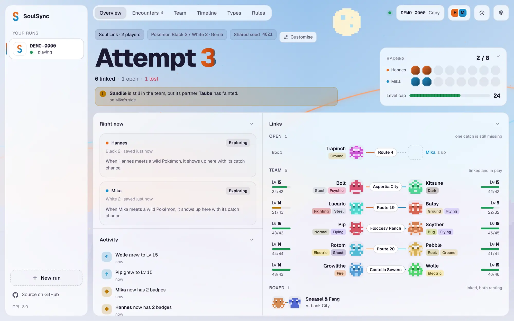
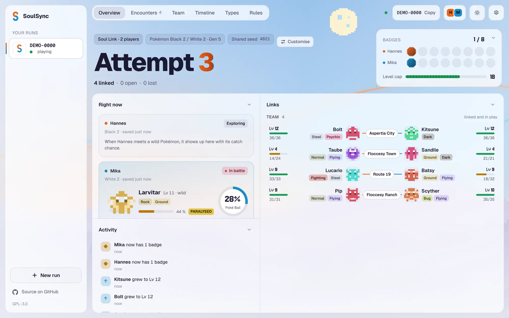
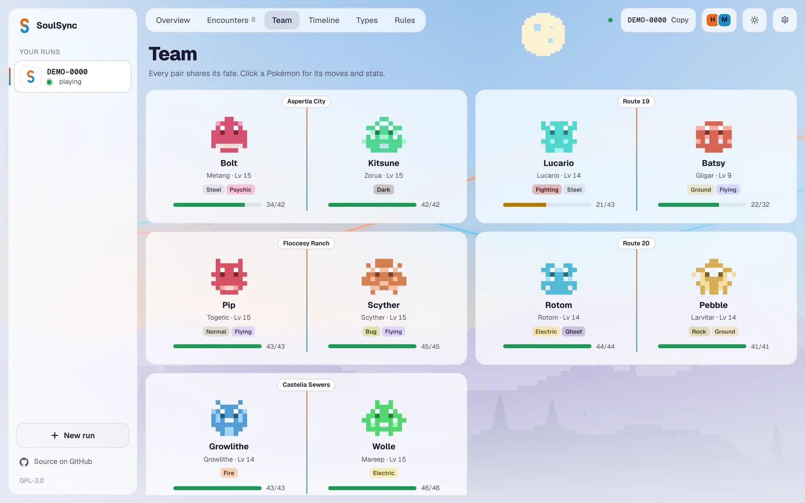
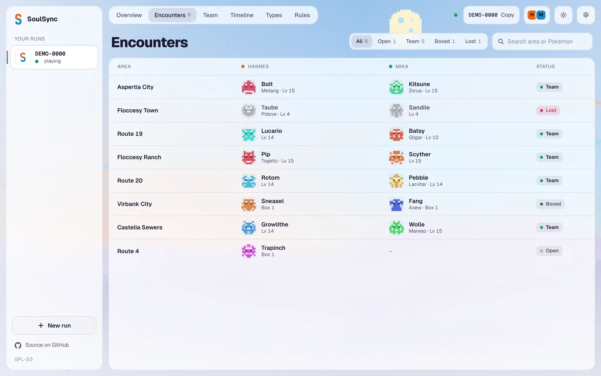

<p align="center"></p>

<h1 align="center">SoulSync</h1>

<p align="center">
  <b>A live tracker for Pokémon Soul Link and Nuzlocke runs, fed straight from your emulator.</b><br>
  No spreadsheets, no manual bookkeeping. Play, and everyone sees the run as it happens.
</p>

<p align="center">
  <a href="https://github.com/hildlabs/SoulSync/releases/latest"></a>
  <a href="https://github.com/hildlabs/SoulSync/actions/workflows/ci.yml"></a>
  <a href="LICENSE"></a>
</p>

<p align="center">
  <picture>
    <source media="(prefers-color-scheme: dark)" srcset="docs/screenshots/overview-dark.webp">
    
  </picture>
</p>

<p align="center"><sub>The dashboard in its demo mode. The figures are placeholder art, see <a href="#legal">Legal</a>.</sub></p>

> [!NOTE]
> **SoulSync is in early development.** So far it has only been tested in the early game of Pokémon Black 2, by two players on Windows with DeSmuME. Black, White and White 2 should work the same way but have not been tested, nor has playing alone. Expect rough edges, and please [report what breaks](https://github.com/hildlabs/SoulSync/issues).

## What it does

In a Soul Link, two or more players play the same game side by side. The first Pokémon each of them catches on a route is linked to the others', and if one faints, its partners are lost too. Keeping track of that by hand gets tedious fast. SoulSync does it for you:

- **Live from the emulator.** A small Lua script inside DeSmuME reads your party, the wild Pokémon you face and your bag while you play. Catches, faints and level-ups show up within a second or two, for everyone in the run.
- **Links and encounters, automatic.** The first encounter of every location is recorded for each player and paired up. A Pokémon you fail to catch closes the location for the whole group.
- **Solo or with up to three friends.** Play a classic Nuzlocke on your own, or a Soul Link with two to four players. Everyone sees all teams, the shared activity feed and who is in battle right now.
- **Rules that watch themselves.** Level caps read from the gym leaders in your ROM, shared fate, "together or not at all", failed catches. SoulSync points out when a team breaks one; it never stops you from playing.
- **Catch odds in battle.** The wild Pokémon's HP, status and the Poké Balls in your bag give the chance to catch it, before you throw.
- **Made for randomizers.** Moves, abilities and learnsets come from each player's own ROM, so a randomized game shows what is really in it. A new attempt rerolls the ROM and restarts the save in one click.
- **Runs that last.** Pause a run, switch to another and come back later. Every attempt keeps its real time played, and once it ends, won or lost, it goes to an archive with its badges and final teams.
- **English and German**, light and dark.

<table>
  <tr>
    <td width="33%"></td>
    <td width="33%"></td>
    <td width="33%"></td>
  </tr>
  <tr>
    <td align="center"><sub>Catch chance, live in battle</sub></td>
    <td align="center"><sub>Every pair shares its fate</sub></td>
    <td align="center"><sub>One row per location</sub></td>
  </tr>
</table>

## Getting started

You need Windows (or a Mac, see [SoulSync on a Mac](docs/mac.md)), [DeSmuME](https://desmume.org) and your own copy of a generation 5 game (Black, White, Black 2 or White 2). SoulSync does not include or download games.

1. **Download** `SoulSync.exe` from the [latest release](https://github.com/hildlabs/SoulSync/releases/latest) and start it. It opens in its own window; new versions are offered in the top bar and install with one click.
2. **Set up once:** enter your name and pick your ROM and your save. For DeSmuME the save is the `.dsv` in its `Battery` folder; SoulSync finds it next to the ROM if it can.
3. **Start a run:** choose how many players it has and your rules, then send the run code to your friends. They choose *Join* and enter it.
4. **Play.** When SoulSync finds DeSmuME next to your save, it sets up the Lua script to start with your game by itself (restart DeSmuME once afterwards). *Settings › Live from DeSmuME* shows whether that worked.

The app plays on the public SoulSync server out of the box, so sharing the code is all it takes. Your ROM and your save never leave your computer; the server only receives what the dashboard shows.

<details>
<summary><b>More about the app</b></summary>

- If the Lua script does not start by itself, load it by hand in DeSmuME: *Tools › Lua Scripting › New Lua Script Window*, choose the file shown under *Settings › Live from DeSmuME* and press *Run*.
- The script only trusts a party that has your own trainer behind it in memory, so an opponent's team is never mistaken for yours.
- What happens in the PC boxes arrives with your next in-game save, so a catch that went straight to a box shows as not caught until you save.
- An encounter recorded by mistake can be removed under *Encounters* with *Remove* next to your entry.
- The run begins with your first catch: if your starter faints before it, as in the first fight against your rival, the link is not lost.
- Under *Server* you can enter your own server instead, or leave it empty to keep the run on your computer.
- Under *Settings › Run › Updates* you can also get preview builds, made from every change and not yet released.
- The window uses the web view that comes with Windows 11. On Windows 10 it needs Microsoft's WebView2 runtime, which most computers already have; without it SoulSync opens in your browser instead.
- *Settings › Report a problem* puts the logs that help find a bug into one zip file. Nothing is sent anywhere.

</details>

## How it works

```
DeSmuME + Lua script ──▶ SoulSync app ──▶ run server ──▶ every player's dashboard
   (party, battle, bag)     (save file, ROM data)   (WebSocket)
```

SoulSync reads the game **from the outside**, through the save file and the emulator's memory, instead of modifying or bundling an emulator. The app turns what it reads into a snapshot and sends it to the run server, which pairs up encounters, applies the rules and pushes the new state to everyone in the run. The dashboard is a web page served by the run server, so anyone with the link can watch along in a browser.

## Roadmap

Next up, roughly in this order:

- [ ] Starting a randomized run without bringing your own randomizer
- [ ] A smoother first start and a signed Windows build
- [ ] An OBS overlay for streamers
- [ ] More games and emulators

See [docs/ROADMAP.md](docs/ROADMAP.md) for the bigger picture. Ideas and bug reports are welcome in the [issues](https://github.com/hildlabs/SoulSync/issues).

## Hosting your own server

The public server is fine for most groups. To run your own:

```sh
cd deploy
SOULSYNC_DOMAIN=soulsync.example.org docker compose --profile https up -d --build
```

This runs the server behind Caddy with HTTPS. The domain must point to the machine, and ports 80 and 443 must be free and open. Players then enter `https://soulsync.example.org` under *Server*.

<details>
<summary><b>Updates, certificates, proxies and limits</b></summary>

Runs are kept in the `runs` volume, so updating the server (`git pull`, then the same command again) does not end them. To update by itself, let cron run `deploy/update.sh`; the script says how. With `SOULSYNC_TRACK=releases` it follows released versions only. Outside Docker, set `SOULSYNC_DATA` to a directory to keep runs across restarts.

The host name your provider gave the machine works as the domain too. Many customers share such a name's domain, so Let's Encrypt often refuses it with a rate limit. Add `SOULSYNC_EMAIL=you@example.org` and Caddy gets the certificate from ZeroSSL instead when that happens.

For a quick test without HTTPS, `SOULSYNC_DOMAIN=:80` serves plain HTTP; players then enter `http://` and the machine's address as the server.

If the machine already runs a reverse proxy, start only the server with `docker compose up -d --build` and point the proxy at `127.0.0.1:3000`, passing WebSocket upgrades through.

A server that anyone can reach keeps itself usable with limits, each set by an environment variable (in `deploy/.env` with Docker):

| Variable | Default | What it limits |
| --- | --- | --- |
| `SOULSYNC_RUNS_PER_HOUR` | 10 | New runs one address may create per hour |
| `SOULSYNC_CONNECTIONS` | 20 | Connections one address may hold at once |
| `SOULSYNC_MAX_RUNS` | 2000 | Runs the server keeps at most |
| `SOULSYNC_IDLE_DAYS` | 60 | Days after which a run nobody changed is removed |
| `SOULSYNC_TRUST_PROXY` | off | `1` takes the address from `X-Forwarded-For`; only behind a proxy nobody can bypass |

`0` turns a limit off. The Docker setup sets `SOULSYNC_TRUST_PROXY=1`, since only the proxy reaches the server's port. A stored run takes about 1.5 MB of memory and 0.6 MB of disk, mostly the move and learnset data from each player's ROM, so the default of 2000 runs fits in 4 GB of RAM.

A build of the app made with `SOULSYNC_SERVER=https://…` starts out with that server instead of the public one.

</details>

## Command line

<details>
<summary><b>Tracking a run and reading saves without the app</b></summary>

```sh
# 1. Start a server (or use one someone else runs)
soulsync-server                      # http://localhost:3000, set PORT to change

# 2. Create a run and share the code with your partner
soulsync new --server http://localhost:3000

# 3. Both players sync their DeSmuME battery file
soulsync sync Battery/SoulLink.dsv --code ZORUA-4821 --name Red --server http://localhost:3000
```

Open `http://localhost:3000/run/ZORUA-4821` to watch the run.

```sh
# Show party, boxes and badges from a DeSmuME battery file
soulsync inspect Battery/SoulLink.dsv

# Watch the save: every in-game save reports catches, faints, evolutions, level-ups and badges
soulsync watch Battery/SoulLink.dsv

# Machine-readable output
soulsync inspect Battery/SoulLink.dsv --json
```

```
Trainer Red · 0 badges

Party (1)
  Party 1      Metang · Lv 5 · HP 21/21 · met at Aspertia City
```

Output is available in English and German. Use `--lang de`, or set `SOULSYNC_LANG=de`.

</details>

## Contributing

SoulSync is written in Rust; the dashboard is a single HTML file without a build step. You need [Rust](https://rustup.rs) 1.75 or newer.

```sh
cargo build --release
cargo test
cargo run -p soulsync-server   # then open http://localhost:3000/demo
```

The demo plays a scripted run, so you can work on the dashboard without a game. Please keep game assets out of the repository: no ROMs, saves, RAM dumps or sprites.

| Crate | Purpose |
| --- | --- |
| [`soulsync-core`](crates/soulsync-core) | Generation 5 data model: PK5 encryption, save parsing, ROM data, species, types and locations, events, Soul Link pairs, sync protocol |
| [`soulsync-server`](crates/soulsync-server) | Run server: run codes, WebSocket sync, the web dashboard |
| [`soulsync-client`](crates/soulsync-client) | Creates runs and keeps a save in sync with a server |
| [`soulsync-app`](crates/soulsync-app) | The desktop app: setup, sync and dashboard in one program, plus the DeSmuME Lua script |
| [`soulsync-cli`](crates/soulsync-cli) | The `soulsync` command-line tool |

**Releasing:** every push to `main` publishes a preview build (a GitHub pre-release `build-<n>`). To release a version, open *Actions › CI › Run workflow* on `main` and enter the version, such as `0.1.0`: it builds `main`, publishes it as *SoulSync 0.1.0* and tags the commit `v0.1.0`. Apps on the default channel only update to such releases.

## Legal

SoulSync is licensed under [GPL-3.0-or-later](LICENSE).

SoulSync is an unofficial fan project and is not affiliated with or endorsed by Nintendo, Creatures or GAME FREAK. Pokémon and its names are trademarks of Nintendo, Creatures and GAME FREAK.

The repository contains no game data or graphics. SoulSync does not include or distribute ROMs; every player uses their own. Sprites are loaded at runtime from a public source while you play and can be turned off with `SOULSYNC_SPRITES=off` on the server. The screenshots in this README use original placeholder figures in their place.
