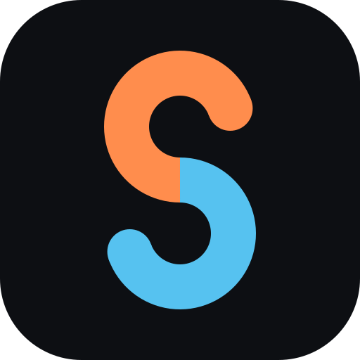

<p align="center"></p>

# SoulSync

Track Pokémon Soul Link runs live, straight from your emulator.

SoulSync reads both players' game state and shows it on one shared dashboard: linked pairs, encounters per route, deaths, level caps and your house rules. No manual bookkeeping. The goal is a single app you send to your partner: enter the run code, pick your own ROM, play.

> **Status:** early development. Black 2 / White 2 saves sync to a shared live dashboard every time a player saves in-game. Live emulator support (no saving needed) is next, see the [roadmap](docs/ROADMAP.md).

## The app

Start `SoulSync` (on Windows: `SoulSync.exe`). It opens in its own window; closing the window quits it:

1. Enter your name and pick your ROM and your save. For DeSmuME the save is the `.dsv` in its `Battery` folder; SoulSync finds it next to the ROM if it can.
2. Start a new run and choose your rules, or join your partner's run with their code.
3. Play. Every in-game save updates the dashboard for both of you.

To play together, both players enter the same run server under *Server*. Without one, the run stays on your computer. Your ROM and your save never leave your machine.

The window uses the web view that comes with Windows 11 and macOS. On Windows 10 it needs Microsoft's WebView2 runtime, which most computers already have; without it SoulSync opens in your browser instead. On Linux it always opens in the browser.

## Hosting a run server

```sh
cd deploy
SOULSYNC_DOMAIN=soulsync.example.org docker compose --profile https up -d --build
```

This runs the server behind Caddy with HTTPS. The domain must point to the machine, and ports 80 and 443 must be free and open.

The host name your provider gave the machine works as the domain too. Many customers share such a name's domain, so Let's Encrypt often refuses it with a rate limit. Add `SOULSYNC_EMAIL=you@example.org` and Caddy gets the certificate from ZeroSSL instead when that happens.

For a quick test without HTTPS, `SOULSYNC_DOMAIN=:80` serves plain HTTP; players then enter `http://` and the machine's address as the server.

If the machine already runs a reverse proxy, start only the server with `docker compose up -d --build` and point the proxy at `127.0.0.1:3000`, passing WebSocket upgrades through. Runs are kept in memory.

## Command line

The same works without the app:

```sh
# 1. Start a server (or use one someone else runs)
soulsync-server                      # http://localhost:3000, set PORT to change

# 2. Create a run and share the code with your partner
soulsync new --server http://localhost:3000

# 3. Both players sync their DeSmuME battery file
soulsync sync Battery/SoulLink.dsv --code ZORUA-4821 --name Red --server http://localhost:3000
```

Open `http://localhost:3000/run/ZORUA-4821` to watch the run.

## Other commands

```sh
# Show party, boxes and badges from a DeSmuME battery file
soulsync inspect Battery/SoulLink.dsv

# Watch the save: every in-game save reports catches, faints, evolutions, level-ups and badges
soulsync watch Battery/SoulLink.dsv

# Machine-readable output
soulsync inspect Battery/SoulLink.dsv --json
```

```
Trainer Red · 0 badges

Party (1)
  Party 1      Metang · Lv 5 · HP 21/21 · met at Aspertia City
```

Output is available in English and German. Use `--lang de`, or set `SOULSYNC_LANG=de`.

## Building

Requires [Rust](https://rustup.rs) 1.75 or newer.

```sh
cargo build --release
cargo test
```

## Project layout

| Crate | Purpose |
| --- | --- |
| [`soulsync-core`](crates/soulsync-core) | Generation 5 data model: PK5 encryption, save parsing, species/types/locations, events, Soul Link pairs, sync protocol |
| [`soulsync-server`](crates/soulsync-server) | Run server: run codes, WebSocket sync, web dashboard |
| [`soulsync-client`](crates/soulsync-client) | Creates runs and keeps a save in sync with a server |
| [`soulsync-app`](crates/soulsync-app) | The desktop app: setup, sync and dashboard in one program |
| [`soulsync-cli`](crates/soulsync-cli) | The `soulsync` command-line tool |

## License

[GPL-3.0-or-later](LICENSE). SoulSync does not include or distribute ROMs; every player uses their own.

Pokémon is a trademark of Nintendo, Creatures and GAME FREAK. SoulSync is an unofficial fan project.
